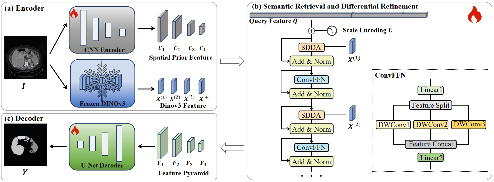

# ReDINO
ReDINO: Structure-Guided Semantic Retrieval and Differential Refinement from Frozen DINOv3 for Medical Image Segmentation



Clone the ReDINO repository:

```bash
git clone https://github.com/friay/ReDino.git
```
